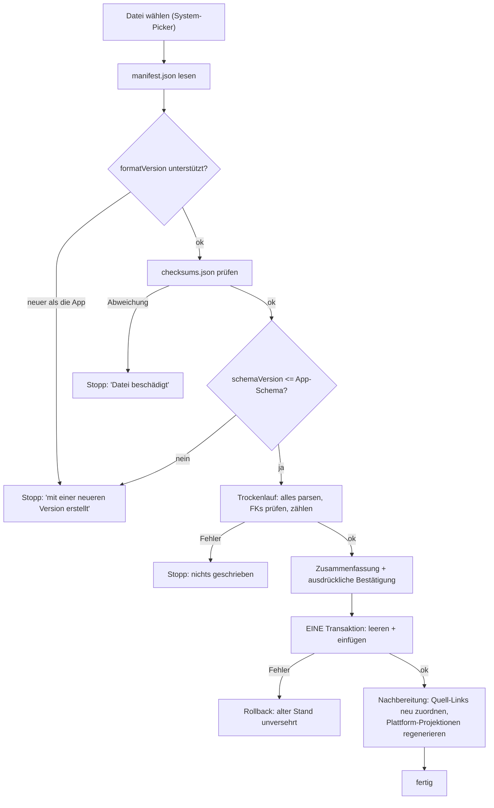

# Backup & Restore

Rezept für ein lokales, manuelles Backup ohne Cloud. Capability-Modul —
kostet ein File-Picker-Paket und eine Entscheidung über Verschlüsselung
(siehe [Capability-Module](capability-modules.md)).

Regeln: [Database Contract](../contracts/02-database.md), Punkte 9 und 10.

## Zuerst: fünf Dinge auseinanderhalten

Der häufigste Entwurfsfehler ist, zwei davon zu vermischen.

| Operation | Umfang |
|---|---|
| **App-Version zurücksetzen** | nur das Binary; Daten unberührt |
| **DB-Schema zurücksetzen** | Schema neu anlegen; Daten weg |
| **Nutzerdaten auf einen früheren Stand** | Daten, Schema unverändert — braucht Snapshots |
| **Backup wiederherstellen** | Daten aus einer externen Datei ersetzen |
| **App-Daten löschen** | alles Lokale weg |

Das Template bringt heute nur die letzte Zeile mit (`wipeAllData()`, auf die
Datenbank beschränkt). Alles andere ist dieses Rezept.

## Format

```text
<app>-backup-YYYY-MM-DD.zip
├── manifest.json
├── data/*.jsonl        eine Zeile je Datensatz, eine Datei je Tabelle
└── checksums.json
```

```json
{
  "app": "todo-app",
  "formatVersion": 1,
  "schemaVersion": 3,
  "appVersion": "2.0.0+1",
  "createdAt": "2026-08-21T10:00:00Z",
  "includesPrivateNotes": true,
  "encrypted": false
}
```

**`formatVersion` und `schemaVersion` sind zwei Zahlen.** Das Archivformat
kann sich ändern, ohne dass das Schema es tut, und umgekehrt. Beide von
Anfang an mitschreiben — nachträglich lässt sich eine Datei ohne
Versionsangabe nicht mehr einordnen.

### JSONL statt SQLite-Dump

| Kriterium | JSONL + Manifest | Roh-Kopie der `.sqlite` |
|---|---|---|
| Portabel über Schema-Versionen | gut — der Import mappt Felder | schlecht — die Datei *ist* das Schema |
| Selektiver Export (Notizen ja/nein) | einfach | ohnehin Umschreiben nötig |
| Inspizierbar bei einem Fehlerbericht | ja | nein |
| Aufwand | höher | fast null |
| Risiko, eine kaputte DB wiederherzustellen | gering | hoch |

Der Dump ist verlockend und die falsche Wahl, sobald es Optionen gibt oder
das Schema sich je ändert.

## Import



Die vier Regeln, die den Ablauf tragen:

1. **Validieren, bevor irgendetwas geschrieben wird.** Der Trockenlauf ist
   kein Luxus: ein Import, der auf halbem Weg scheitert, hinterlässt einen
   Zustand, den niemand mehr erklären kann.
2. **Kein partieller Restore.** Eine Transaktion, sonst gar nichts.
3. **Kein stilles Zusammenführen.** Erst der vollständige Restore, Merge —
   wenn überhaupt — als eigenes, späteres Feature mit eigener UX.
4. **„Neuer als die App" ist ein verständlicher Fehler**, kein Absturz und
   kein Versuch, es trotzdem zu lesen.

## Was hinein gehört — und was nicht

| Daten | Export? | Grund |
|---|---|---|
| Fachdaten des Nutzers | **ja** | unersetzlich |
| Einstellungen | **ja** | klein, für den Nutzer bedeutsam |
| Links zu externen Quellen | **ja, als Hinweis** | die externe Entität selbst gehört der App nicht |
| Ownership-Zuordnungen für Plattform-Writes | **nein** | Provider-IDs sind auf einem neuen Gerät bedeutungslos — regenerieren |
| Abgeleitete/berechnete Daten | **nein** | entstehen neu |
| Diagnoseprotokolle | **nein** | kurzlebig, absichtlich begrenzt |
| Gerätekontakte, Kalendereinträge | **niemals** | nicht die Daten der App |

Nach dem Import werden Quell-Links **zerstörungsfrei** neu zugeordnet: was
sich nicht wiederfindet, wird `sourceMissing`, nicht gelöscht.

## Datenschutz

- Das Archiv enthält personenbezogene Daten. Vor dem Erstellen **und** vor
  dem Teilen darauf hinweisen; der Dateiname sollte es erkennbar machen.
- Nur über System-Picker (SAF) — keine pauschale Speicherberechtigung.
- Kein automatischer Upload, nirgendwohin.
- Option „private Notizen einschließen: ja/nein", falls die App solche kennt.
- Verschlüsselung ist eine eigene Entscheidung und hängt an derselben Frage
  wie die Verschlüsselung der Datenbank im Ruhezustand. Bis sie getroffen
  ist: `"encrypted": false` ehrlich ins Manifest schreiben.

## Android Auto Backup

Unabhängig davon: ohne `android:allowBackup`-Angabe gilt der Plattform-Default,
und der kann die Datenbank in das Google-Konto des Nutzers sichern. Für eine
App, die „deine Daten bleiben auf dem Gerät" verspricht, ist das eine
Entscheidung, die getroffen und dokumentiert gehört — nicht eine, die man
erbt.

## Tests

- **Round-Trip:** exportieren → `wipeAllData()` → importieren → Daten
  gleichwertig. Das ist der eine Test, der das Feature trägt.
- Golden-Archive je `formatVersion` als Fixtures.
- Beschädigte Prüfsumme → Abbruch, nichts geschrieben.
- Zu neues `formatVersion` → verständliche Meldung.
- Fehler mitten in der Transaktion → alter Stand unversehrt.
